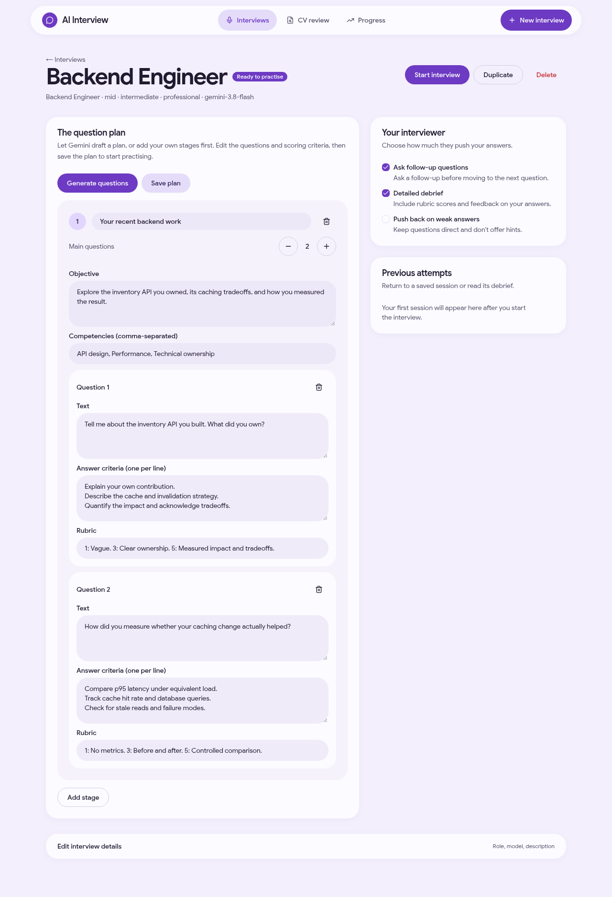
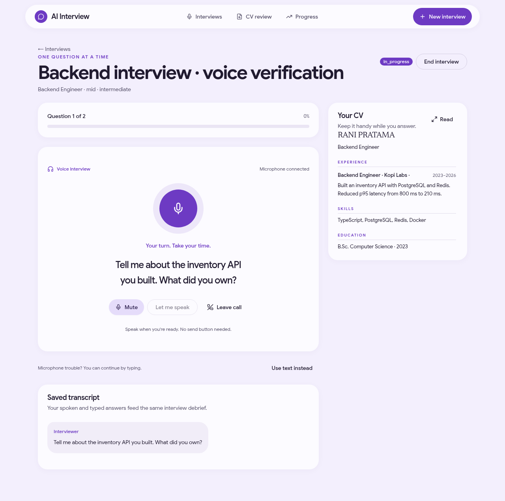
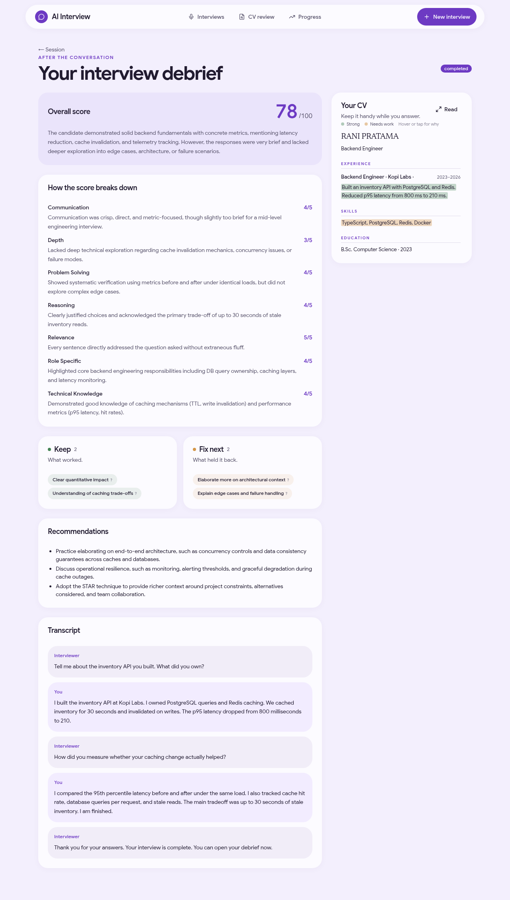
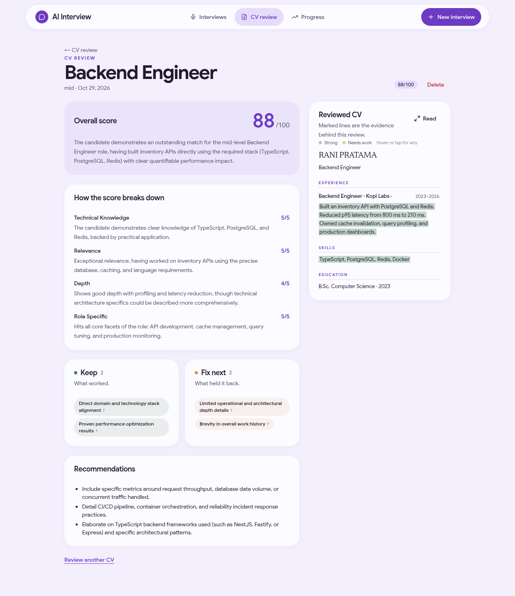
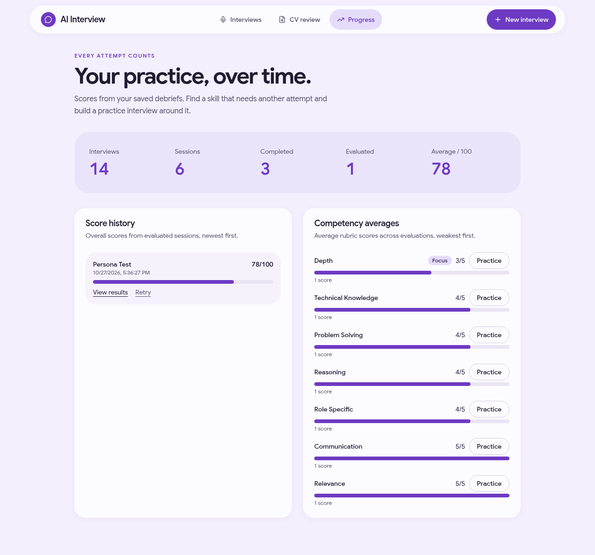

# ai-interview

A mock-interview app with a standalone CV reviewer. Configure a role, let Gemini
write the question plan, answer out loud, and get the transcript scored against a
rubric. Or skip the interview and review a CV against the role you are applying
for.

## Features

- **Interview builder.** Pick the role, level, difficulty, language, persona, and
  model, and optionally attach a PDF CV. Gemini drafts stages with questions,
  answer criteria, and rubrics; every part stays editable.
- **Voice interview.** Gemini Live asks questions aloud, and you answer through
  your microphone. Mute or interrupt when needed, or switch to text without
  losing your spoken draft. Saved answers feed the same transcript and debrief,
  with dynamic follow-ups and strict mode.
- **Debrief.** Rubric scores per competency, a summary, strengths and fixes (each
  with a reason), recommendations, and the CV marked line by line as strong or
  weak evidence.
- **CV review.** A standalone pass with no interview: choose the target role, add
  the CV, and get the same report plus highlighted evidence. Reviews are saved,
  reopenable, and deletable.
- **Progress.** Score history and competency averages, with one-click practice
  interviews focused on the weakest competency.

## Voice interview demo

[Watch the 42-second recording with audio](assets/voice-interview-demo.mp4).

The recording shows the interviewer asking a question, microphone mute and
unmute, live transcription, and the completed interview. The candidate voice and
CV are synthetic; the interviewer uses real Gemini Live responses.

## Screenshots

The screenshots use fictional demo data and the current purple theme.

**Interview builder.** Stages, questions, criteria, and rubrics, all editable.



**Voice interview.** Answer through your microphone with your CV beside the call.
Select the image to open the demo recording.

[](assets/voice-interview-demo.mp4)

**Debrief.** Rubric scores, strengths and fixes, and the CV marked with evidence.



**CV review.** The same report without running an interview.



**Progress.** Score history and competency averages, with practice shortcuts.



## How it works

1. **Build the brief.** Set the role, level, difficulty, language, persona, and
   model. Optionally upload a PDF CV; Gemini extracts its text and keeps it as
   context. Toggle follow-ups, detailed feedback, and strict mode.
2. **Generate the plan.** Gemini returns stages with questions, answer criteria,
   and rubrics. Edit anything, then save.
3. **Answer out loud.** Start a voice interview and allow microphone access.
   Gemini reads the question, listens, and submits your spoken answer. The server
   saves its transcript before returning a follow-up or the next planned
   question. The interview closes when the plan runs out. Text is a fallback if
   you cannot use the microphone.
4. **Read the debrief.** Evaluating a completed session scores each rubric
   category and writes a summary, strengths, improvements, and recommendations.
5. **Track progress.** Scores and competency averages feed the Progress page,
   which can create a practice interview for the weakest competency.

Audio is processed by Gemini. The app saves the text transcript, not an audio
recording. The demo video above was captured separately. Voice requires
microphone permission and a secure browser context, either HTTPS or localhost.
The microphone animation respects `prefers-reduced-motion`.

**CV review** reuses the same report shape without a session: pick the role and
level, add the CV, and Gemini scores the fit, lists strengths and fixes, and marks
verbatim CV lines as strong or weak. Saved reviews live under `/cv-reviews`.

## Stack

| Concern     | Choice                                           |
| ----------- | ------------------------------------------------ |
| Monorepo    | Turborepo + Bun workspaces                       |
| Web         | TanStack Start + TanStack Query + TanStack Form  |
| API         | Elysia 2 (`2.0.0-rc.0`) + Effect v4              |
| API client  | Eden Treaty (`@elysia/eden`)                     |
| Contracts   | Effect Schema in `packages/shared`               |
| UI          | shadcn/ui (new-york) + Motion for React          |
| ORM         | Drizzle + PostgreSQL 16                          |
| AI          | TanStack AI with Gemini (text, structured, live) |
| API docs    | OpenAPI + Scalar at `/openapi`                   |
| Lint/format | oxlint + oxfmt                                   |
| Local dev   | devenv (Nix) + direnv                            |

## Layout

```text
apps/
  api/
    src/modules/     interview, interview/plan, session, evaluation,
                     cv, cv-review, gemini, progress, practice, health
    drizzle/         SQL migrations
  web/
    src/routes/      route definitions only
    src/features/    home, interviews, interview-new, interview-builder,
                     interview-live, interview-results, cv-review, progress
packages/
  components/        shadcn/ui (@ai-interview/ui)
  shared/            Effect Schema contracts (@ai-interview/shared)
  typescript-config/
.agents/             CONTEXT.md and reusable skills
```

## Getting started

```bash
cp .env.example .env          # add GEMINI_API_KEY
devenv up                     # Postgres 16 and the dev shell
bun install
bun run --filter api db:migrate
bun run dev                   # web + api in parallel
```

- Web: http://localhost:3000 (proxies `/api` to the API)
- API: http://localhost:3001
- API docs: http://localhost:3001/openapi

Without devenv, run Postgres 16 with Podman instead: `podman-compose up -d` (see
`compose.yaml`). It publishes 5433 by default so it can share a host with another
Postgres; set `DATABASE_URL` to that port and `API_PORT` to a free port in `.env`,
and export `DATABASE_URL` in your shell for the `db:*` scripts, which read the
environment rather than `.env`. The web proxy follows `API_PORT`.

The Gemini key stays server-side. The web never sees it, including when it asks
for a realtime token.

## API

All routes live under `/api` and return the `{ ok, data }` envelope.

| Area        | Routes                                                               |
| ----------- | -------------------------------------------------------------------- |
| Interviews  | `GET/POST /interviews`, `GET/PUT/DELETE /interviews/:id`             |
| Settings    | `PUT /interviews/:id/behavior`, `POST /interviews/:id/duplicate`     |
| Plan        | `GET/PUT /interviews/:id/plan`, `POST /interviews/:id/generate-plan` |
| CV          | `POST /cv/extract`                                                   |
| CV review   | `GET/POST /cv-reviews`, `GET/DELETE /cv-reviews/:id`                 |
| Sessions    | `GET/POST /interviews/:id/sessions`, `GET /sessions/:id`             |
| Session run | `POST /sessions/:id/start`, `/answer`, `/end`, `/realtime-token`     |
| Evaluation  | `POST /sessions/:id/evaluate`, `GET /sessions/:id/evaluation`        |
| Other       | `GET /progress`, `POST /practice`, `GET /models`, `GET /health`      |

## Scripts

```bash
bun run dev              # run everything
bun run dev --filter web
bun run dev --filter api
bun run build
bun run check-types
bun run test
bun run lint
bun run lint:fix
bun run fmt
bun run fmt:check

bun run --filter api db:generate
bun run --filter api db:migrate
bun run --filter api db:studio
```

## Conventions

- **One envelope.** Success is `{ ok: true, data }`; failure is
  `{ ok: false, error: { code, message, issues? }, requestId }`.
- **Effect where it earns its keep.** Pure logic stays a plain function. Use
  `Context.Service` + `Layer` + `ManagedRuntime` only for real effects: async work,
  typed errors, resources, dependencies.
- **`yield*` inside Effect, `await` only at the boundary** (an Elysia handler or
  `runtime.runPromise`).
- **API modules** are `index.ts` (thin controller), `service.ts`, `error.ts`
  (`Schema.TaggedError`), `mapper.ts` (row to wire type). Add each module's layer
  to `src/runtime.ts`.
- **Web features** are `page.tsx` with `components/` and `hooks/`; `routes/` only
  defines the route.
- **Schemas are the contract.** `packages/shared` drives Elysia validation, Eden
  types, frontend decoding, and OpenAPI. Wire timestamps are ISO strings.

## Verification

```bash
.agents/skills/verifying-ai-interview/scripts/checks.sh
```

Runs typecheck, tests, lint, format check, and build in one batch. For UI changes,
render the affected pages and inspect them; the skill covers the workflow.

## Agent guidance

`AGENTS.md` at the root and in each package describes the module layout and rules.
`.agents/CONTEXT.md` records the architecture decisions, and `.agents/skills/`
holds the reusable skills (`building-api-modules`, `building-web-features`,
`verifying-ai-interview`).

## License

[MIT](LICENSE) © Syahrul Bhudi Ferdiansyah
